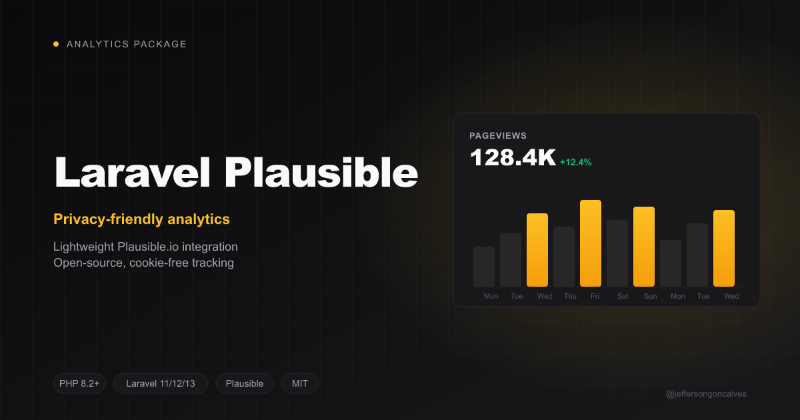

<div class="filament-hidden">



</div>

# Laravel Plausible

[](https://buymeacoffee.com/jeffersongoncalves)

[](https://packagist.org/packages/jeffersongoncalves/laravel-plausible)
[](https://github.com/jeffersongoncalves/laravel-plausible/actions?query=workflow%3A"Fix+PHP+code+styling"+branch%3Amain)
[](https://packagist.org/packages/jeffersongoncalves/laravel-plausible)

A lightweight Laravel package that seamlessly integrates Plausible Analytics into your Blade views. Plausible.io is a privacy-friendly, open-source alternative to Google Analytics.

Settings are stored in the database using [spatie/laravel-settings](https://github.com/spatie/laravel-settings), making it easy to manage from an admin panel or programmatically.

## Installation

Install the package via Composer:

```bash
composer require jeffersongoncalves/laravel-plausible
```

Publish and run the settings table migration from `spatie/laravel-settings` (if not already done):

```bash
php artisan vendor:publish --provider="Spatie\LaravelSettings\LaravelSettingsServiceProvider" --tag="migrations"
php artisan migrate
```

Publish and run the Plausible settings migration:

```bash
php artisan vendor:publish --tag=plausible-settings-migrations
php artisan migrate
```

## Usage

### Include the script in your layout

Add the following to your Blade layout (inside `<head>`):

```blade
@include('plausible::script')
```

With `script_id` set, the package renders Plausible's current per-site snippet (`<script async src=".../js/pa-XXXX.js">` + `plausible.init()`) — see Plausible's [script update guide](https://plausible.io/docs/script-update-guide). Otherwise it renders the legacy `data-domain` snippet when `domains` is set (keep that for multi-dashboard rollups, which the new script does not support). Nothing renders when both are empty.

### Configure settings

You can update the settings programmatically:

```php
use JeffersonGoncalves\Plausible\Settings\PlausibleSettings;

$settings = app(PlausibleSettings::class);
$settings->domains = 'example.com';
$settings->save();
```

#### Available settings

| Setting | Type | Default | Description |
|---------|------|---------|-------------|
| `domains` | `?string` | `null` | Domain(s) to track. Supports rollup reporting with comma-separated domains. |
| `host_analytics` | `string` | `https://plausible.io` | Plausible host URL. Change this if you are self-hosting Plausible. |
| `script_id` | `?string` | `null` | Per-site script id from the current snippet (`pa-XXXX`; a `.js` suffix or the full script URL also works). Wins over `domains`. |

Upgrading from an earlier version? Run `php artisan migrate` — a new settings migration adds `plausible.script_id`.

### Self-hosted Plausible

If you are self-hosting Plausible, update the `host_analytics` setting:

```php
$settings = app(PlausibleSettings::class);
$settings->host_analytics = 'https://analytics.example.com';
$settings->save();
```

## Content Security Policy

When your app sets a CSP nonce through Laravel's Vite (`Vite::useCspNonce()`, as [laravel-security-headers](https://github.com/jeffersongoncalves/laravel-security-headers) does), every `<script>` this package renders carries it, so a `script-src 'self' 'nonce-{nonce}'` policy works without `'unsafe-inline'`. Scripts loaded afterwards from the vendor's own CDN still need that host in `script-src` (and its API in `connect-src`).

## Testing

```bash
composer test
```

## Changelog

Please see [CHANGELOG](CHANGELOG.md) for more information on what has changed recently.

## Contributing

Please see [CONTRIBUTING](.github/CONTRIBUTING.md) for details.

## Security Vulnerabilities

Please review [our security policy](../../security/policy) on how to report security vulnerabilities.

## Credits

- [Jefferson Goncalves](https://github.com/jeffersongoncalves)
- [All Contributors](../../contributors)

## License

The MIT License (MIT). Please see [License File](LICENSE.md) for more information.
